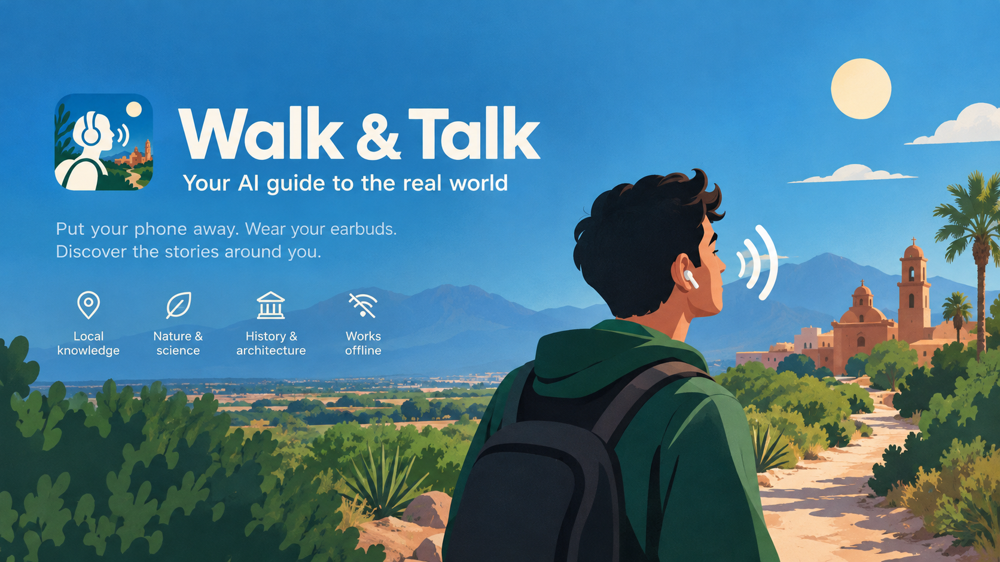
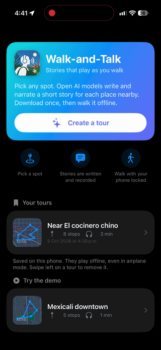
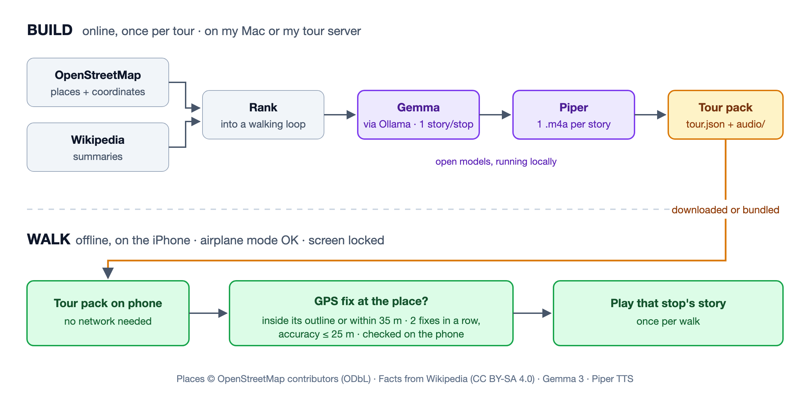

# Walk & Talk

An offline audio walking tour: pick a spot, and open models write and voice a short story for each place nearby. Then you lock your phone, walk, and each story plays as you arrive, even in airplane mode.

Built for the DEV "Touch Grass" challenge. Story text comes from Gemma (via Ollama) and audio from Piper, both running on hardware I control. No paid AI APIs, no user accounts.



## How it works



1. **Pick a spot**: drop a pin or search an address, choose a radius (200 m–2 km) and 3–12 stops.
2. **Build**: the pipeline finds named places (landmarks, museums, churches, theatres, parks, sports grounds and plazas, with malls only as filler when an area is short of places), ranks them into a loop, has Gemma write a story from those facts only, and has Piper record it. Each story is written to stand on its own, with no references to other stops, since you may reach them in any order or skip some. A 10-stop tour takes about 1.5 minutes on a Mac and about 6 on Railway's CPUs.
3. **Review and keep**: the numbered route on a map; keep it or start again.
4. **Walk**: the app watches GPS on the phone and plays each story once when you arrive, in whatever order you reach the stops. Arriving means 2 GPS fixes in a row with accuracy ≤ 25 m within 35 m of the place: anywhere inside or near its outline for parks, ballparks, plazas and buildings, or near its point for a statue or plaque. Audio and location keep running with the screen locked.
5. **Finish**: "Stop walk" shows stops reached, time and distance, and lets you play the stories of any stops you missed.

**Where your location goes.** During a walk, nowhere: GPS is matched against the stops on the phone, with no network. Building a tour sends one start point to whatever builds it (your Mac, or my server, which deletes packs after 24 hours), and the pipeline sends that area to OpenStreetMap's Overpass API and Wikipedia to look up places.

## Quick start: pipeline (Mac)

Needs Python 3, [Ollama](https://ollama.com), and about 12 GB of disk for the models.

```bash
python3 -m venv .venv
source .venv/bin/activate
pip install -r pipeline/requirements.txt -r server/requirements.txt
ollama pull gemma3:4b
ollama pull gemma3:12b
python -m piper.download_voices en_US-lessac-medium --data-dir pipeline/voices
python pipeline/check_env.py
```

Build a tour pack and check it:

```bash
python pipeline/build_tour.py --route mexicali --lat 32.661938 --lon -115.489149 --radius 500 --lang en --exclude way/423032194
python pipeline/validate_tour.py tours/mexicali/tour.json
```

Steps, one file each in `pipeline/`: `fetch_pois` (Overpass) → `fetch_wiki` (Wikipedia summaries) → `rank` (walking loop) → `write_stories` (Gemma) → `narrate` (Piper → .m4a). Output: `tours/<route>/` (`tour.json`, `audio/`, `build_log.txt`). Working files, including `review.md` (each story next to its source facts), go to `pipeline/work/<route>/`. Every network, LLM and TTS call is cached in `pipeline/cache/`; `--no-cache` rebuilds from scratch. Settings: `pipeline/config.py`.

## Quick start: tour server (optional)

The app's "Create a tour" needs a server. To run it locally:

```bash
API_KEYS=dev-key DATA_DIR=server/data uvicorn --app-dir server app:app --port 8000
```

Endpoints, Railway deployment and curl examples: [server/README.md](server/README.md). Model choice and Mac vs Railway timings: [docs/backend.md](docs/backend.md).

## Quick start: iOS app

1. Open `ios/WalkAndTalk/WalkAndTalk.xcodeproj` in Xcode (first time: [docs/xcode-setup.md](docs/xcode-setup.md)).
2. Copy `ios/WalkAndTalk/Secrets.example.swift` to `ios/WalkAndTalk/WalkAndTalk/App/Secrets.swift` (git-ignored). The defaults point at `http://localhost:8000` with key `dev-key`, which the Simulator reaches directly.
3. Run on a Simulator or a phone. The bundled `mexicali2` tour works with no server at all.
4. To fake a walk in the Simulator: Debug → Simulate Location → `ios/WalkAndTalk/GPX/mexicali2-walk.gpx`.
5. Tests: ⌘U (24 unit tests). Field-test procedure: [docs/walk-test.md](docs/walk-test.md).

## Layout

```
pipeline/   Python steps that build tour packs (used by the command line and the server)
server/     Tour server: FastAPI + pipeline + Piper, Docker image for Railway
tours/      Tour packs, one folder per route
ios/        Xcode project (SwiftUI app)
docs/       Setup guides, backend measurements, field test, DEV post draft
```

## Models, data and licenses

| What | Used for | License / terms |
| --- | --- | --- |
| [Gemma 3](https://ai.google.dev/gemma) `gemma3:4b`, `gemma3:12b` | Writing stories | [Gemma Terms of Use](https://ai.google.dev/gemma/terms) and [Prohibited Use Policy](https://ai.google.dev/gemma/prohibited_use_policy) |
| [Ollama](https://github.com/ollama/ollama) | Running Gemma locally | MIT |
| [Piper](https://github.com/OHF-Voice/piper1-gpl) | Text to speech | GPL-3.0 (`piper-tts` 1.3+) |
| Piper voice `en_US-lessac-medium` | English narration | See the voice's [model card](https://huggingface.co/rhasspy/piper-voices/tree/main/en/en_US/lessac/medium) <!-- TODO: confirm exact license text --> |
| Piper voice `es_MX-claude-high` | Spanish narration | See the voice's [model card](https://huggingface.co/rhasspy/piper-voices/tree/main/es/es_MX/claude/high) <!-- TODO: confirm --> |
| [OpenStreetMap](https://www.openstreetmap.org/copyright) via Overpass API | Places and coordinates | © OpenStreetMap contributors, [ODbL 1.0](https://opendatacommons.org/licenses/odbl/) |
| [Wikipedia](https://www.wikipedia.org) summaries | Facts for stories | Text under [CC BY-SA 4.0](https://creativecommons.org/licenses/by-sa/4.0/) |

Each stop in `tour.json` lists its `sources` (the OSM element and, when used, the Wikipedia article). Stories derived from Wikipedia text are adaptations under CC BY-SA 4.0. Map tiles in the app are Apple Maps (MapKit).

The code in this repo is under the [MIT License](LICENSE). Models, voices and data keep their own licenses above.

## Credits

- Place data © OpenStreetMap contributors.
- Facts from Wikipedia contributors.
- Gemma by Google DeepMind. Piper by Michael Hansen and the Open Home Foundation; the `lessac` voice is trained on the Lessac dataset.
- Built by Martin Espericueta for the DEV "Touch Grass" challenge.
